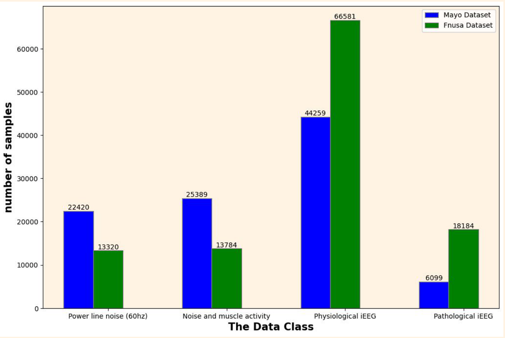
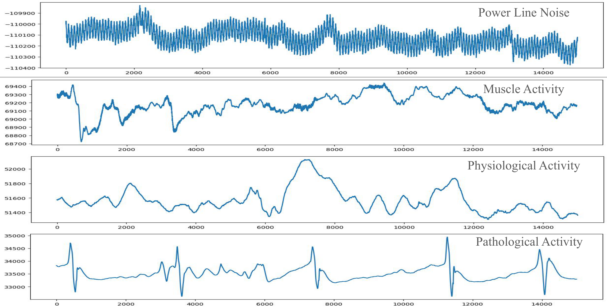
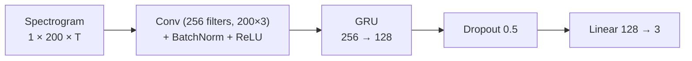
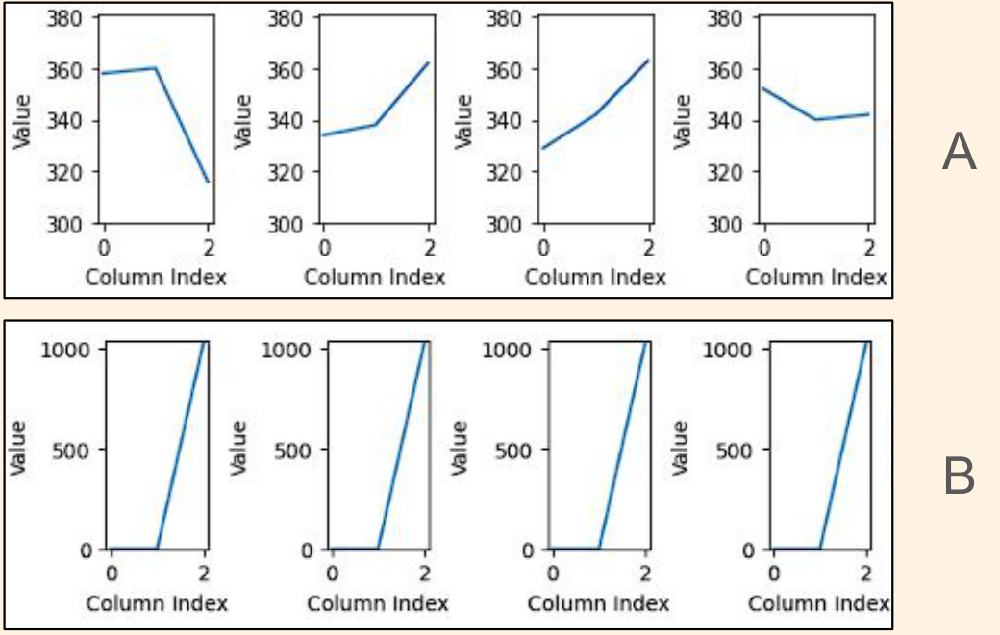
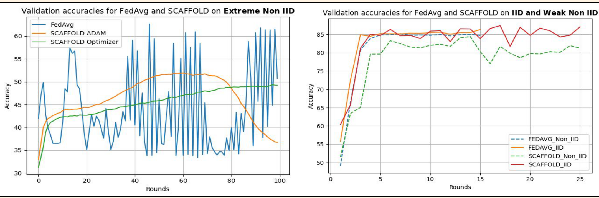

# Classification of iEEG Data with Federated Learning

Code for my Bachelor's thesis, **"Classification of EEG Data with Federated Learning"**
(Moscow Institute of Physics and Technology, 2024; supervisor: Aleksandr Beznosikov, PhD).

📄 [Thesis (PDF)](docs/thesis.pdf) · 🖥️ [Defense slides (PDF)](docs/presentation.pdf)

## Overview

Medical recordings are among the most privacy-sensitive data, so hospitals rarely pool them in one place.
Federated learning (FL) trains a shared model while every client keeps its data local. FL benchmarks
mostly cover tabular and image data. This project studies FL on **intracranial EEG (iEEG)**:

- Two FL algorithms, **FedAvg** and **SCAFFOLD**, are used to train a CNN-GRU classifier of iEEG segments.
- The study measures how the **distribution of data across clients** (IID, weak non-IID, extreme non-IID) affects them.
- Models are trained on one hospital and **tested on a different hospital** (out-of-institution evaluation).

**Key results:**

- FedAvg reaches a **Cohen's κ of 0.70**, on par with the centralized baseline (κ = 0.71).
- Under extreme label imbalance, FedAvg collapses (κ = 0.14) and oscillates between rounds.
- SCAFFOLD with plain SGD and a small learning rate trains stably in that setting and doubles κ to 0.30.

## Dataset

[Multicenter intracranial EEG dataset](https://www.kaggle.com/datasets/nejedlypetr/multicenter-intracranial-eeg-dataset)
(Nejedly et al.). It contains 3-second, single-channel segments (15,000 samples at 5 kHz) recorded from patients
with drug-resistant epilepsy and annotated manually:

| Institution | Patients | Role in this study |
|---|---|---|
| St. Anne's University Hospital, Brno (FNUSA) | 11 | training, split across federated clients |
| Mayo Clinic, Rochester (Mayo) | 25 | validation and out-of-institution test set |

<p align="center"></p>

The power-line noise class is removed. That leaves three classes: **noise / muscle activity**,
**physiological iEEG**, and **pathological iEEG** (e.g. interictal spikes). The training data is undersampled
to 13,784 segments per class to remove class bias.

<p align="center"></p>

## Method

**Preprocessing.** Each segment is turned into a spectrogram (`nperseg=256`, `noverlap=128`, `nfft=1024`).
Only the first 200 frequency bins are kept, and each frequency band is z-scored.

**Model.** The CNN-GRU is adapted from Nejedly et al.:



**Data distribution across 40 clients.**

| Setting | How the FNUSA data is split |
|---|---|
| IID | every client gets an equal share of every class |
| Weak non-IID (label-distribution skew) | class proportions per client drawn from a Dirichlet distribution |
| Extreme non-IID (quantity-based label imbalance) | each client only holds one or two of the three classes |

<p align="center"></p>

**Algorithms.**

- **FedAvg** averages client models, weighted by local dataset size.
- **SCAFFOLD** adds server and client *control variates* `c` and `c_i`. They correct each local gradient step
  (`y_i ← y_i − η_l (g_i(y_i) + c − c_i)`) and so reduce client drift on heterogeneous data.
- Local optimizer: Adam, or plain SGD with the SCAFFOLD correction (the "SCAFFOLD optimizer" in the thesis).

## Results

Results on the Mayo Clinic test set; the models never saw Mayo data during training.
The centralized baseline reaches **F1 0.77 · κ 0.71 · AUROC 0.93**.

| Algorithm | Local optimizer | Data setting | LR | Rounds | F1 | κ | AUROC |
|---|---|---|---|---|---|---|---|
| FedAvg | Adam | IID | 1e-3 | 15 | 0.76 | 0.67 | 0.94 |
| FedAvg | Adam | Weak non-IID | 1e-3 | 15 | **0.78** | **0.70** | **0.94** |
| FedAvg | Adam | Extreme non-IID | 1e-3 | 100 | 0.45 | 0.14 | 0.57 |
| SCAFFOLD | Adam | IID | 1e-3 | 25 | 0.66 | 0.53 | 0.94 |
| SCAFFOLD | Adam | Weak non-IID | 1e-3 | 25 | 0.70 | 0.57 | 0.93 |
| SCAFFOLD | Adam | Extreme non-IID | 3e-4 | 100 | 0.31 | 0.05 | 0.70 |
| SCAFFOLD | SCAFFOLD (SGD) | Extreme non-IID | 1e-4 | 100 | **0.50** | **0.30** | 0.69 |

<p align="center"></p>

**Takeaways**

- With IID or mildly skewed clients, FedAvg matches the centralized model. In that regime it is the better
  choice over SCAFFOLD.
- With extreme label imbalance, FedAvg's validation accuracy swings by more than 20 points from round to round,
  even after 100 rounds.
- SCAFFOLD with the drift-corrected SGD optimizer is the only configuration that trains steadily in that setting.
  It mitigates the problem but does not close the gap to the baseline. Longer training was limited by the
  compute available (Kaggle).

## Repository structure

```
fl_eeg/                  library code
  data.py                dataset, spectrogram preprocessing, IID / Dirichlet / label-sorted partitions
  model.py               CNN-GRU classifier
  federated.py           FedAvg and SCAFFOLD (server aggregation + client updates)
  metrics.py             accuracy, macro F1, Cohen's kappa, macro AUROC
scripts/
  build_index.py         builds the segment index CSV from the Kaggle folders
  train.py               runs one federated experiment end to end
notebooks/
  scaffold_kaggle.ipynb  original Kaggle notebook used for the thesis SCAFFOLD runs
data/sample/             a few raw .mat segments for a quick look at the data format
docs/                    thesis, slides, and figures
```

## Reproducing

```bash
pip install -r requirements.txt
```

Download the dataset from Kaggle and place `DatasetFnusa/` and `DatasetMayo/` under `data/`. Then build the index files:

```bash
python scripts/build_index.py data/DatasetFnusa data/fnusa.csv --max-per-class 13784
python scripts/build_index.py data/DatasetMayo data/mayo.csv
```

Run the thesis configurations:

```bash
python scripts/train.py --algorithm fedavg   --optimizer adam --partition iid            --lr 1e-3 --rounds 15  --out runs/fedavg_iid
python scripts/train.py --algorithm fedavg   --optimizer adam --partition weak-noniid    --lr 1e-3 --rounds 15  --out runs/fedavg_weak
python scripts/train.py --algorithm fedavg   --optimizer adam --partition extreme-noniid --lr 1e-3 --rounds 100 --out runs/fedavg_extreme
python scripts/train.py --algorithm scaffold --optimizer adam --partition iid            --lr 1e-3 --rounds 25  --out runs/scaffold_iid
python scripts/train.py --algorithm scaffold --optimizer adam --partition weak-noniid    --lr 1e-3 --rounds 25  --out runs/scaffold_weak
python scripts/train.py --algorithm scaffold --optimizer adam --partition extreme-noniid --lr 3e-4 --rounds 100 --out runs/scaffold_adam_extreme
python scripts/train.py --algorithm scaffold --optimizer sgd  --partition extreme-noniid --lr 1e-4 --rounds 100 --out runs/scaffold_sgd_extreme
```

Each run prints per-round validation metrics and the final test confusion matrix. It writes `model.pt` and
`results.json` to its `--out` folder. Run `python scripts/train.py --help` to see all options.

> The thesis experiments were run in Kaggle notebooks (see `notebooks/`). The `fl_eeg` package is a
> cleaned-up rewrite of that code, so numbers from a fresh run can differ somewhat from the table above.

## References

- P. Nejedly et al., *Multicenter intracranial EEG dataset for classification of graphoelements and artifactual signals*, Scientific Data, 2020.
- P. Nejedly et al., *Exploiting graphoelements and convolutional neural networks with long short term memory for classification of the human electroencephalogram*, Scientific Reports, 2019.
- B. McMahan et al., *Communication-Efficient Learning of Deep Networks from Decentralized Data*, AISTATS 2017.
- S. P. Karimireddy et al., *SCAFFOLD: Stochastic Controlled Averaging for Federated Learning*, ICML 2020.

## Citation

```bibtex
@thesis{eid2024fleeg,
  author = {Mostafa Eid},
  title  = {Classification of EEG Data with Federated Learning},
  school = {Moscow Institute of Physics and Technology},
  type   = {Bachelor's thesis},
  year   = {2024}
}
```
